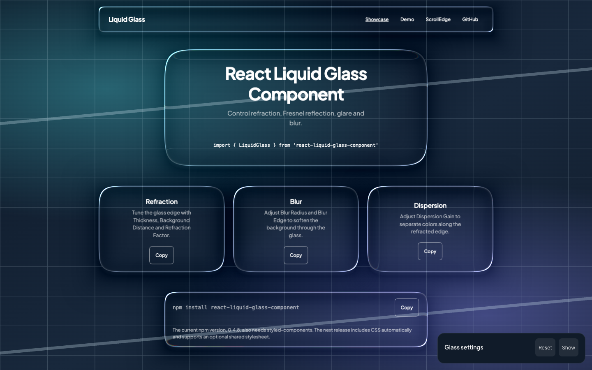
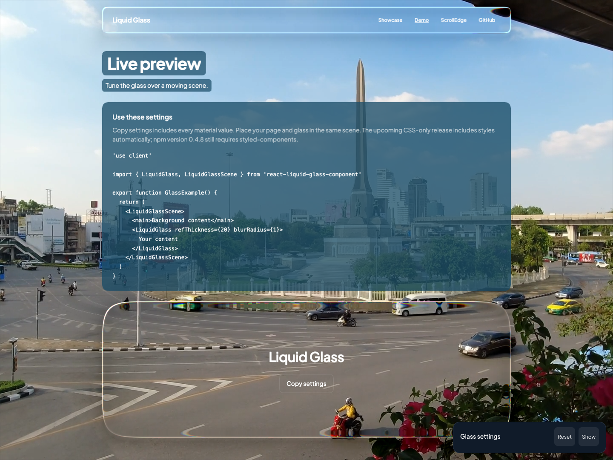
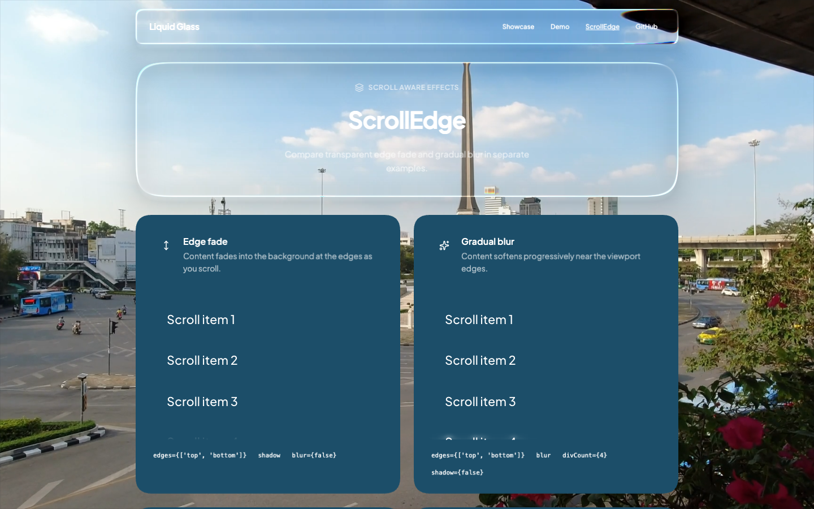

# React Liquid Glass

React components for refracted glass surfaces, managed WebGL scenes, and scroll edge effects.

[](https://www.npmjs.com/package/react-liquid-glass-component)
[](LICENSE)

## Demo

- [Showcase](https://react-liquid-glass-component.vercel.app/)
- [Live demo](https://react-liquid-glass-component.vercel.app/demo)
- [ScrollEdge](https://react-liquid-glass-component.vercel.app/scroll-edge)







Sites using the package include [KA Technology](https://dev.kacorptech.com/) and [Code Terminal](https://codeterminal.io/).

## Install

```bash
npm install react-liquid-glass-component styled-components
```

The host app must provide React 18 or newer, React DOM 18 or newer, and styled-components 6 or newer.
In the Next.js App Router, import the components from a client component marked `'use client'`.

## Quick start

Use `LiquidGlass` by itself for a single surface:

```tsx
import { LiquidGlass } from 'react-liquid-glass-component'

export function Card() {
  return (
    <LiquidGlass className="card" borderRadius={24} blur={12}>
      <h2>Hello</h2>
      <p>Content stays as normal React.</p>
    </LiquidGlass>
  )
}
```

`width` and `height` default to `auto`, so CSS, `className`, or `style` controls the size. Native HTML attributes and a ref to the root element are forwarded.

## Managed scenes

`LiquidGlassScene` owns one canvas for the page. Put the background content and every managed glass pane inside it. The component reads supported text, images, SVG, video, canvas, colors, gradients, borders, and layout changes automatically.

```tsx
import { LiquidGlass, LiquidGlassScene } from 'react-liquid-glass-component'

export function Page() {
  return (
    <LiquidGlassScene background="#142334">
      <main>
        <h1>Managed glass</h1>
        <p>The scene keeps the canvas and page content in sync.</p>
        <LiquidGlass refThickness={24} refFactor={1.4}>
          <button type="button">Open</button>
        </LiquidGlass>
      </main>
    </LiquidGlassScene>
  )
}
```

| Prop             | Default                    | Purpose                                                              |
| ---------------- | -------------------------- | -------------------------------------------------------------------- |
| `background`     | page or wrapper background | Base color behind the scene.                                         |
| `maxPixelRatio`  | `2`                        | Backing resolution cap.                                              |
| `presentation`   | `scene`                    | Show the whole scene or use `glass-only` to limit it to a pane.      |
| `onStatusChange` | —                          | Receives `ready`, `pending`, or `fallback`; the latter include reasons. |
| `canvasContainer` | —                    | Optional fixed container for the composed canvas in `glass-only` mode. |

For a fixed navigation bar, `presentation="glass-only"` keeps the surrounding page native and shows the canvas inside one enclosing pane:

```tsx
<LiquidGlassScene presentation="glass-only">
  <main>Page content</main>
  <LiquidGlass refThickness={20} shapeRadius={100} shapeRoundness={2} shadowFactor={0}>
    <nav aria-label="Primary">Navigation</nav>
  </LiquidGlass>
</LiquidGlassScene>
```

For a fixed navigation bar on iOS, pass the fixed element that contains every managed pane.
The scene mounts its canvas inside that element so the canvas and native
controls stay together during elastic scrolling:

```tsx
import { useState } from 'react'
import { LiquidGlass, LiquidGlassScene } from 'react-liquid-glass-component'

export function FixedNavigation() {
  const [navigation, setNavigation] = useState<HTMLElement | null>(null)

  return (
    <LiquidGlassScene presentation="glass-only" canvasContainer={navigation}>
      <main>Page content</main>
      <nav ref={setNavigation} style={{ position: 'fixed' }}>
        <LiquidGlass shapeRadius={100} shapeRoundness={2} shadowFactor={0}>
          <button type="button">Open</button>
        </LiquidGlass>
      </nav>
    </LiquidGlassScene>
  )
}
```

The container must be inside the scene, use `position: fixed`, and have no scale. Its
ancestors must not use `transform`, `perspective`, or `filter`; every registered pane must
be inside the container. Unsupported geometry reports `fallback` and keeps native HTML
visible. Omitting `canvasContainer` keeps the default canvas placement.
Passing `null` waits for the fixed element to mount before starting the scene.

All panes must fit inside one enclosing pane, which must fit inside the scene and viewport. Glass-only mode requires `shapeRoundness={2}`, `shadowFactor={0}` and CSS `clip-path` support.

In glass-only mode, the scene can briefly retain its last rendered frame while images or SVGs load. `onStatusChange` reports `pending` during this interval; the previous backdrop can remain visible until the new frame is ready. If loading takes too long or the scene encounters unsupported content, it reports `fallback` and shows the original HTML.

When the scene cannot compile part of the page, the original HTML remains visible and the scene reports the reason. Some generated content, masks, CSS effects, deeply nested clipping, rotation, perspective, iframes, Shadow DOM, and active native editing controls remain unsupported. Portals outside the scene are not captured, and text selection is not mirrored into the canvas. Cross-origin media needs CORS permission.

## Glass options

Inside a scene, `LiquidGlass` accepts these material options. Omitted values use the defaults shown.

| Prop               | Default | Prop                  | Default |
| ------------------ | ------: | --------------------- | ------: |
| `refThickness`     |    `20` | `refDistance`         |  `0.05` |
| `refFactor`        |   `1.4` | `refDispersion`       |     `7` |
| `refFresnelRange`  |    `30` | `refFresnelHardness`  |    `20` |
| `refFresnelFactor` |    `20` | `glareRange`          |    `30` |
| `glareHardness`    |    `20` | `glareFactor`         |    `90` |
| `glareConvergence` |    `50` | `glareOppositeFactor` |    `80` |
| `glareAngle`       |   `-45` | `blurRadius`          |     `1` |
| `blurEdge`         |  `true` | `shadowExpand`        |    `25` |
| `shadowFactor`     |    `15` | `shapeRadius`         |    `80` |
| `shapeRoundness`   |     `5` | `convexity`           |     `0` |

`tint` defaults to `{ r: 255, g: 255, b: 255, a: 0 }` and `shadowPosition` to `{ x: 0, y: -10 }`. `shapeRadius` is a percentage of half the shorter side. `shapeWidth` and `shapeHeight` are pixel aliases; explicit `width` and `height` take precedence. `convexity` is a flat-to-rounded body lens from `0` to `1`; when it is omitted, `magnification` defaults to `1`.

`GLASS_STUDIO_DEFAULTS` and `GLASS_STUDIO_RANGES` are exported for controls and presets:

```tsx
import { GLASS_STUDIO_DEFAULTS, LiquidGlass, LiquidGlassScene } from 'react-liquid-glass-component'

export function Preset() {
  return (
    <LiquidGlassScene>
      <LiquidGlass {...GLASS_STUDIO_DEFAULTS} refThickness={28}>
        Preset content
      </LiquidGlass>
    </LiquidGlassScene>
  )
}
```

## ScrollEdge

Import `ScrollEdge` from the root package or the tree-shaken subpath. It renders an outer wrapper and an inner `.scroll-edge__scrollable` viewport.

### Fade content into the background

```tsx
import { ScrollEdge } from 'react-liquid-glass-component/scroll-edge'

export function FadeList() {
  return (
    <ScrollEdge edges={['top', 'bottom']} shadowSize={24} style={{ height: 240 }}>
      {Array.from({ length: 20 }, (_, index) => (
        <p key={index}>Item {index + 1}</p>
      ))}
    </ScrollEdge>
  )
}
```

Parent mode uses transparent CSS masks. It fades content into whatever is behind the viewport and does not paint a shadow color. Vertical and horizontal masks can run together.

### Blur without the fade

```tsx
import { ScrollEdge } from 'react-liquid-glass-component/scroll-edge'

export function BlurList() {
  return (
    <ScrollEdge shadow={false} blur divCount={4} style={{ height: 240 }}>
      {Array.from({ length: 20 }, (_, index) => (
        <p key={index}>Item {index + 1}</p>
      ))}
    </ScrollEdge>
  )
}
```

| Prop           | Default             | Purpose                                              |
| -------------- | ------------------- | ---------------------------------------------------- |
| `edges`        | `['top', 'bottom']` | `top`, `bottom`, `left`, or `right`.                 |
| `shadow`       | `true`              | Enables the transparent content fade in parent mode. |
| `blur`         | `false`             | Adds gradual backdrop blur layers.                   |
| `shadowSize`   | `24`                | Fade length.                                         |
| `edgeSize`     | `'24px'`            | Blur overlay size.                                   |
| `blurStrength` | `1`                 | Blur multiplier.                                     |
| `divCount`     | `8`                 | Number of blur layers.                               |
| `exponential`  | `true`              | Use exponential blur growth.                         |
| `curve`        | `'bezier'`          | Blur curve.                                          |
| `disabled`     | `false`             | Disable all edge effects.                            |
| `target`       | `'parent'`          | Use `'page'` for compatibility overlay mode.         |
| `responsive`   | `false`             | Select `edgeSize` from responsive size props.        |
| `animated`     | `false`             | Use `'scroll'` to observe visibility.                |

`shadowColor` is deprecated in parent mode. It remains available for `target="page"`, which keeps fixed colored overlay behavior. `onScroll` receives events from the inner scrolling element; `ref` points to the outer wrapper.

The `react-liquid-glass-component/scroll-edge` entry also exports `ScrollEdgePosition`, `ScrollEdgeCurve`, and `ScrollEdgePreset`.

For the complete props and defaults, see the [API reference](https://github.com/SAHAJOHN/react-liquid-glass-component/blob/main/docs/knowledge/api.md).

## Browser notes

Standalone glass uses SVG and WebKit fallbacks. Managed scenes use one WebGL canvas. If capture or GPU rendering fails, the original HTML remains available. Animated media and fast scrolling can require more work from mobile browsers.

## Local development

```bash
npm install
npm run typecheck
npm test
npm run lint
npm run build

cd web
yarn install
yarn dev
```

The demo uses the published package version in `web/package.json`. To test local library changes, temporarily switch it to `file:..`, run the root build, and sync `dist/` into `web/node_modules/react-liquid-glass-component/dist/`.
See the [setup guide](https://github.com/SAHAJOHN/react-liquid-glass-component/blob/main/docs/knowledge/setup.md) for the full workflow.

For a production-style local build:

```bash
LIQUID_GLASS_DIST_DIR=.next-preview-local yarn build --webpack
```

## Exports

The root entry exports `LiquidGlass`, `LiquidGlassScene`, `GLASS_STUDIO_DEFAULTS`, `GLASS_STUDIO_RANGES`, and `ScrollEdge` with their public types. The `react-liquid-glass-component/scroll-edge` entry exports `ScrollEdge` and its union types.

## License

[MIT](LICENSE)
