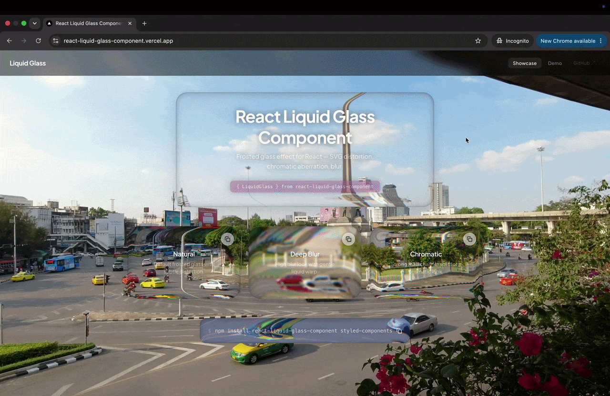
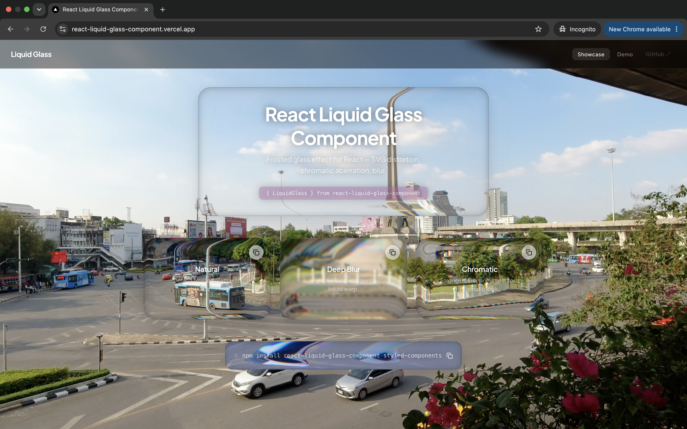
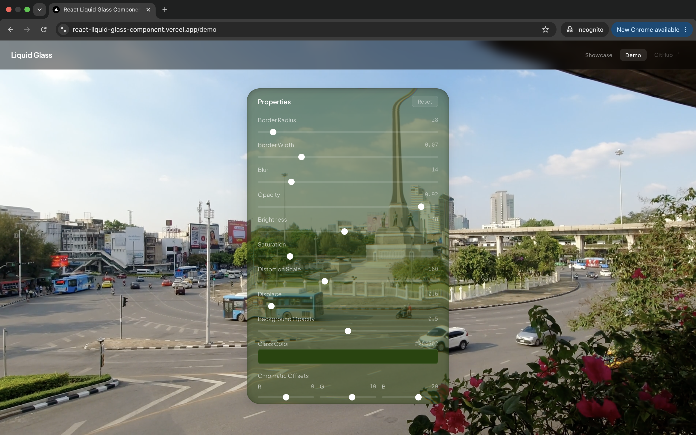

# LiquidGlass

[](https://www.npmjs.com/package/react-liquid-glass-component)
[](https://opensource.org/licenses/MIT)
[](https://bundlephobia.com/package/react-liquid-glass-component)

> React glass surfaces with SVG filtering, chromatic refraction, and an optional managed WebGL scene.

---

## Table of Contents

- [Demo](#demo)
- [Sites using LiquidGlass](#sites-using-liquidglass)
- [Screenshots](#screenshots)
- [Install](#install)
- [Quick Start](#quick-start)
- [Managed Scene](#managed-scene)
- [ScrollEdge](#scrolledge)
- [Features](#features)
- [Props](#standalone-props-and-compatibility)
- [Examples](#examples)
- [CSS Custom Properties](#css-custom-properties)
- [SSR Note](#ssr-note)
- [How It Works](#how-it-works)
- [Browser Support](#browser-support)
- [Local Development](#local-development)
- [License](#license)

---

## Demo



> 👉 **Try the interactive demo at [react-liquid-glass-component.vercel.app](https://react-liquid-glass-component.vercel.app)**

---

## Sites using LiquidGlass

- [KA Technology](https://dev.kacorptech.com/)
- [Code Terminal](https://codeterminal.io/)

---

## Screenshots

| Showcase                                                                                                                 | Interactive Demo                                                                                                 |
| ------------------------------------------------------------------------------------------------------------------------ | ---------------------------------------------------------------------------------------------------------------- |
|  |  |

---

## Install

```bash
npm install react-liquid-glass-component styled-components
```

> The host application needs `react >=18`, `react-dom >=18`, and `styled-components >=6`.

---

## Quick Start

```tsx
import { LiquidGlass } from 'react-liquid-glass-component'

function App() {
  return (
    <LiquidGlass borderRadius={24} blur={12}>
      <h1>Hello, world</h1>
      <p>Behind the glass.</p>
    </LiquidGlass>
  )
}
```

`width` and `height` default to `'auto'` — omit them to let CSS or the `style` prop control sizing.

---

## Managed Scene

`LiquidGlassScene`, the Studio material props, and `ScrollEdge` require `0.3.0` or newer.
Published npm `0.2.1` does not contain these exports. Use the local package while
developing, or install a published `0.3.0+` release before importing them from npm.
Wrap the content behind your glass once. Keep using ordinary HTML/React and the existing
`LiquidGlass` component; the library creates and updates its own canvas.

```tsx
import { LiquidGlass, LiquidGlassScene } from 'react-liquid-glass-component'

export function Page() {
  return (
    <LiquidGlassScene background="#142334">
      <main>
        <h1>My page</h1>
        
        <LiquidGlass refThickness={20} refDistance={0.05} refFactor={1.4}>
          <button onClick={() => console.log('clicked')}>Open</button>
        </LiquidGlass>
      </main>
    </LiquidGlassScene>
  )
}
```

The scene automatically reads text, nested inline styles, colors, solid borders, gradients,
images, inline SVG, video and canvas elements. It tracks layout, content, font and media
changes. Translate/scale/opacity animations update without rebuilding unchanged text
textures. Background, content and glass share one scroll position and one completed frame.
No scene markers, shader code or canvas drawing code are required.

The demo site uses this same scene path on Showcase, Demo and ScrollEdge. Its shared
navbar is part of the scene, while the native Studio controls stay outside the scene so
form inputs remain interactive. Demo and ScrollEdge use a direct `<video>` source when
needed; the browser does not need a second video-mirror canvas. The ScrollEdge examples
keep their scrollable text in app-local native portals that follow scene-frame geometry.
Those portals are a page composition detail, not general DOM refraction support.

| Scene prop              | Default            | Purpose                                                                        |
| ----------------------- | ------------------ | ------------------------------------------------------------------------------ |
| `background`            | Wrapper/page color | Opaque base behind the scene. Place background images inside the wrapper.      |
| `maxPixelRatio`         | `2`                | Upper resolution limit, also subject to the two-million-pixel viewport budget. |
| `onStatusChange`        | —                  | Receives `{ status: 'ready' }` or `{ status: 'fallback', reasons: string[] }`. |
| HTML attributes / `ref` | —                  | Forwarded to the scene's root `div`.                                           |

This is an experimental renderer for a supported HTML/CSS subset, not a replacement for
the browser's rendering engine. Unsupported content keeps the original HTML visible and
reports the reason through `onStatusChange`. Current limitations include CSS shadows,
generated pseudo-content, masks, rotation/perspective, iframes, Shadow DOM, complex nested
rounded clipping, native select/checkbox controls and active text editing. Text selection
is not mirrored into the canvas. Static images are cached; use video or canvas for animated
media. External image/video sources need CORS permission.

Include the actual DOM behind the glass inside the wrapper. Portals outside its DOM
boundary are not captured. Avoid transformed scene ancestors.

### Studio material props

Managed surfaces use the material controls and raw defaults from
[Liquid Glass Studio](https://github.com/iyinchao/liquid-glass-studio/blob/f7b28c36305a862f5cffed3ddd51511cf1204f56/src/Controls.tsx#L72-L238).
The renderer adapts its SDF refraction, dispersion, Gaussian blur, Fresnel, glare,
shadow and superellipse shading. It does not use the earlier SVG-map mask for this path.

| Prop                  | Default                            | Range / meaning                                       |
| --------------------- | ---------------------------------- | ----------------------------------------------------- |
| `refThickness`        | `20`                               | 1–80 CSS px, refracting edge thickness                |
| `refDistance`         | `0.05`                             | 0–0.2, optical background distance                    |
| `refFactor`           | `1.4`                              | 1–4, refraction factor                                |
| `refDispersion`       | `7`                                | 0–50, RGB dispersion gain                             |
| `refFresnelRange`     | `30`                               | 0–100, Fresnel size                                   |
| `refFresnelHardness`  | `20`                               | 0–100                                                 |
| `refFresnelFactor`    | `20`                               | 0–100, Fresnel intensity                              |
| `glareRange`          | `30`                               | 0–100, glare size                                     |
| `glareHardness`       | `20`                               | 0–100                                                 |
| `glareFactor`         | `90`                               | 0–120, glare intensity                                |
| `glareConvergence`    | `50`                               | 0–100                                                 |
| `glareOppositeFactor` | `80`                               | 0–100, opposite-side glare                            |
| `glareAngle`          | `-45`                              | -180–180 degrees                                      |
| `blurRadius`          | `1`                                | 1–200 rendering pixels, Gaussian radius               |
| `blurEdge`            | `true`                             | Use the blurred source throughout the refracting edge |
| `tint`                | `{ r: 255, g: 255, b: 255, a: 0 }` | RGB 0–255, alpha 0–1                                  |
| `shadowExpand`        | `25`                               | 2–100                                                 |
| `shadowFactor`        | `15`                               | 0–100, shadow intensity                               |
| `shadowPosition`      | `{ x: 0, y: -10 }`                 | Each axis -20–20, using the reference's Y convention  |
| `shapeRadius`         | `80`                               | 1–100 percent of half the shorter side                |
| `shapeRoundness`      | `5`                                | 2–7, superellipse exponent                            |

`GLASS_STUDIO_DEFAULTS` and `GLASS_STUDIO_RANGES` are exported for controls, presets
and Reset behavior. Showcase and Demo use these values directly, with no extra black
tint or legacy distortion overrides.

```tsx
import { GLASS_STUDIO_DEFAULTS, LiquidGlass, LiquidGlassScene } from 'react-liquid-glass-component'

export function StudioExample() {
  return (
    <LiquidGlassScene>
      <LiquidGlass {...GLASS_STUDIO_DEFAULTS} refThickness={28} glareFactor={65}>
        Content
      </LiquidGlass>
    </LiquidGlassScene>
  )
}
```

The center is flat by default. `convexity={0}` is our optional extension; increase it
from 0–1 to add a body lens. Explicit `magnification` remains available when convexity
is omitted, with a default of 1. Neither extension is required for the reference look.
Pane children are painted on top and remain sharp.

Sizing remains CSS-controlled. Optional `shapeWidth` / `shapeHeight` alias pixel sizes;
set both to `200` for the reference studio's initial shape dimensions. Existing `width`
and `height` props take precedence. Scene/editor settings such as backend selection,
background selection, spring animation and a second merging shape are not per-pane props.

Compatibility aliases are `thickness` → `refThickness`, `displace` → `blurRadius`,
and the magnitude of `distortionScale` → `refDistance`. Explicit canonical props win.
`glassColor` / `backgroundOpacity` and pixel `borderRadius` are used only when canonical
`tint` / `shapeRadius` are omitted. Other SVG-map-specific controls belong to the standalone
renderer; use the Studio names above inside `LiquidGlassScene`.

Reference defaults and formulas are preserved, but the backing-resolution budget and
browser rasterization can affect pixel-level results. A real iPhone comparison is still
needed for device-specific visual/performance acceptance. Adapted source notices are in
[THIRD_PARTY_NOTICES.md](THIRD_PARTY_NOTICES.md).

The demo repository includes `web/scripts/verify-responsive-pages.mjs`, which checks all
three routes at 33 viewport combinations and exercises the mobile menu, native controls,
ScrollEdge scrolling, portal alignment and route cleanup. Run it against a running web
preview, for example `node web/scripts/verify-responsive-pages.mjs http://127.0.0.1:3102`.

For Next.js, import these components from a module with `'use client'`.

---

## ScrollEdge

With the default `target="parent"`, `ScrollEdge` fades scrollable content into its actual
background at active edges using CSS masks. The fade follows the scroll position and can
be combined with gradual blur. `shadowSize` controls the fade length and `shadow={false}`
disables it. `shadowColor` is deprecated for `target="parent"` and has no effect on that
transparent fade. Parent fade length is clamped between zero and half the viewport on
each axis.
For compatibility, `target="page"` retains its colored fixed overlays and continues to
use `shadowColor`; it does not mask content outside the component.

```tsx
import { ScrollEdge } from 'react-liquid-glass-component/scroll-edge'

export function ScrollExample() {
  return (
    <ScrollEdge edges={['top', 'bottom']} shadowSize={24} style={{ height: 240 }}>
      {Array.from({ length: 20 }, (_, index) => (
        <p key={index}>Item {index + 1}</p>
      ))}
    </ScrollEdge>
  )
}
```

To show blur without the fade, pass `shadow={false}` and `blur`:

```tsx
import { ScrollEdge } from 'react-liquid-glass-component/scroll-edge'

export function BlurExample() {
  return (
    <ScrollEdge shadow={false} blur divCount={4} style={{ height: 240 }}>
      {Array.from({ length: 20 }, (_, index) => (
        <p key={index}>Item {index + 1}</p>
      ))}
    </ScrollEdge>
  )
}
```

The component renders an internal `.scroll-edge__scrollable` viewport and forwards the
root `ref` to the outer wrapper. Put content inside the component; do not depend on the
outer ref being the scrolling element. The parent target uses nested CSS masks so vertical
and horizontal fades can work together without `mask-composite`.

| Prop                                        | Type                             |               Default | Description                                                                           |
| ------------------------------------------- | -------------------------------- | --------------------: | ------------------------------------------------------------------------------------- |
| `edges`                                     | `ScrollEdgePosition[]`           |   `['top', 'bottom']` | Edges to observe: `top`, `bottom`, `left`, `right`.                                   |
| `shadow`                                    | `boolean`                        |                `true` | Enables the transparent parent fade, or the colored page overlay for `target="page"`. |
| `blur`                                      | `boolean`                        |               `false` | Adds gradual `backdrop-filter` layers at the selected edges.                          |
| `disabled`                                  | `boolean`                        |               `false` | Disables masks and overlays.                                                          |
| `shadowSize`                                | `number \| string`               |                  `24` | Parent fade length in pixels or CSS units.                                            |
| `shadowColor`                               | `string`                         | `rgba(0, 0, 0, 0.55)` | Deprecated for `target="parent"`; retained for the legacy page overlay.               |
| `blurStrength`                              | `number`                         |                   `1` | Blur strength multiplier.                                                             |
| `edgeSize`                                  | `string`                         |                `24px` | Blur overlay size.                                                                    |
| `divCount`                                  | `number`                         |                   `8` | Number of blur layers. KA-style examples commonly use `4`.                            |
| `exponential`                               | `boolean`                        |                `true` | Uses exponential blur growth across layers.                                           |
| `curve`                                     | `ScrollEdgeCurve`                |              `bezier` | Layer curve: `linear`, `bezier`, `ease-in`, `ease-out`, or `ease-in-out`.             |
| `opacity`                                   | `number`                         |                   `1` | Blur layer opacity.                                                                   |
| `zIndex`                                    | `number`                         |                `1000` | Overlay stacking order.                                                               |
| `animated`                                  | `boolean \| 'scroll'`            |               `false` | Animates opacity, or observes visibility with `'scroll'`.                             |
| `duration`                                  | `string`                         |                `0.3s` | Animation duration.                                                                   |
| `easing`                                    | `string`                         |            `ease-out` | CSS transition easing.                                                                |
| `responsive`                                | `boolean`                        |               `false` | Enables responsive blur edge sizing.                                                  |
| `mobileSize` / `tabletSize` / `desktopSize` | `string`                         |                     — | `edgeSize` values at ≤480px, ≤768px, and ≤1024px; wider screens use `edgeSize`.       |
| `preset`                                    | `ScrollEdgePreset`               |                     — | Named preset such as `subtle`, `intense`, `header`, or `footer`.                      |
| `hoverIntensity`                            | `number`                         |                     — | Multiplies blur strength while an overlay is hovered.                                 |
| `target`                                    | `'parent' \| 'page'`             |              `parent` | Parent masks content. Page keeps the legacy fixed colored overlay.                    |
| `dependencies`                              | `React.DependencyList`           |                  `[]` | Values that trigger edge observer setup again.                                        |
| `onScroll`                                  | `UIEventHandler<HTMLDivElement>` |                     — | Receives scroll events from the internal viewport.                                    |
| `onAnimationComplete`                       | `() => void`                     |                     — | Called after a visibility animation completes.                                        |
| `ref`                                       | `Ref<HTMLDivElement>`            |                     — | Ref to the outer wrapper, not the internal scrolling element.                         |

The root package exports `ScrollEdge` and `ScrollEdgeProps`. The tree-shaken subpath
`react-liquid-glass-component/scroll-edge` also exports `ScrollEdgePosition`,
`ScrollEdgeCurve`, and `ScrollEdgePreset`.

The preset names are `top`, `bottom`, `left`, `right`, `subtle`, `intense`, `smooth`,
`sharp`, `header`, `footer`, `sidebar`, `page-header`, and `page-footer`.

Preset values are resolved in this order: explicit props, then the selected preset, then
component defaults. For example, `preset="subtle"` supplies its blur settings while an
explicit `divCount` still wins. The `page-header` and `page-footer` presets select
`target="page"` unless you override `target` explicitly.
`onAnimationComplete` runs only for `animated="scroll"` after the component becomes visible.
For that callback, use a duration in seconds such as `0.3s`: the current implementation
parses the numeric value as seconds, including when a different CSS unit is supplied.

---

## Features

- 🧊 **Liquid Distortion** — Real-time SVG displacement map that morphs the background behind the glass
- 🌈 **Chromatic Aberration** — Per-channel RGB offset for a prismatic glass effect
- 🌀 **Auto-sizing** — Displacement map regenerates on resize via `ResizeObserver`
- 🪶 **Lazy capture** — DOM capture is loaded only when the WebKit renderer needs it
- 🧩 **TypeScript** — Full type definitions with strict mode support
- ♿ **Accessible** — Extends `HTMLAttributes`, passes native props, supports keyboard focus
- 📉 **Fallback Chain** — SVG filter → WebGL DOM capture on WebKit → CSS glass
- 🎨 **15+ Configurable Props** — Blur, brightness, opacity, saturation, displacement, channel offsets, and more

---

## Standalone props and compatibility

| Prop                | Type                  | Default                    | Description                                                                                         |
| ------------------- | --------------------- | -------------------------- | --------------------------------------------------------------------------------------------------- |
| `children`          | `ReactNode`           | `null`                     | Content inside the glass pane                                                                       |
| `width`             | `number \| string`    | `'auto'`                   | Width (`number` = px, `string` = CSS unit; omit for CSS control)                                    |
| `height`            | `number \| string`    | `'auto'`                   | Height (`number` = px, `string` = CSS unit; omit for CSS control)                                   |
| `borderRadius`      | `number`              | `20`                       | Corner radius in px                                                                                 |
| `borderWidth`       | `number`              | `0.07`                     | Edge inset ratio for the inner glass border                                                         |
| `brightness`        | `number`              | `50`                       | Brightness of the glass fill (0–100)                                                                |
| `opacity`           | `number`              | `0.93`                     | Opacity of the glass fill                                                                           |
| `blur`              | `number`              | `11`                       | Frosted blur amount in px                                                                           |
| `displace`          | `number`              | `0`                        | Post-filter Gaussian blur on the output                                                             |
| `backgroundOpacity` | `number`              | `0`                        | Frost background opacity (`--glass-frost`)                                                          |
| `glassColor`        | `string`              | `light-dark(white, black)` | Glass tint color — any CSS color value                                                              |
| `saturation`        | `number`              | `1`                        | Saturation multiplier (`--glass-saturation`)                                                        |
| `distortionScale`   | `number`              | `-180`                     | Intensity of the liquid distortion (negative inverts the warp)                                      |
| `thickness`         | `number`              | `20`                       | Compatibility alias for managed `refThickness`; canonical prop takes precedence.                    |
| `convexity`         | `number`              | `0`                        | Managed body curvature, 0–1. Zero is flat. Takes precedence over `magnification`.                   |
| `magnification`     | `number`              | `1`                        | Advanced managed body magnification when `convexity` is omitted. Standalone SVG usage is unchanged. |
| `redOffset`         | `number`              | `0`                        | Extra displacement offset for the red channel                                                       |
| `greenOffset`       | `number`              | `0`                        | Extra displacement offset for the green channel                                                     |
| `blueOffset`        | `number`              | `0`                        | Extra displacement offset for the blue channel                                                      |
| `xChannel`          | `'R' \| 'G' \| 'B'`   | `'R'`                      | Source channel for red displacement                                                                 |
| `yChannel`          | `'R' \| 'G' \| 'B'`   | `'G'`                      | Source channel for green/blue displacement                                                          |
| `mixBlendMode`      | CSS blend-mode string | `'difference'`             | RGB blend mode; see `LiquidGlassProps` for accepted values.                                         |
| `ref`               | `Ref<HTMLDivElement>` | —                          | Forwarded ref to the root element                                                                   |
| HTML attributes     | —                     | —                          | `className`, `style`, `tabIndex`, `aria-*`, `data-*`, `onClick`, etc.                               |

> The component extends `React.HTMLAttributes<HTMLDivElement>`. Any native HTML attribute is forwarded to the root element via `...rest`.

---

## Examples

### Basic Usage

```tsx
import { LiquidGlass } from 'react-liquid-glass-component'
;<LiquidGlass borderRadius={24} blur={12}>
  <h1>Hello</h1>
  <p>Behind the glass.</p>
</LiquidGlass>
```

### Chromatic Aberration

```tsx
<LiquidGlass
  borderRadius={16}
  redOffset={18}
  greenOffset={0}
  blueOffset={-18}
  distortionScale={-300}
>
  <h2>Prismatic</h2>
</LiquidGlass>
```

### Circular Glass

```tsx
<LiquidGlass borderRadius={50} width={100} height={100} blur={8}>
  <span>LG</span>
</LiquidGlass>
```

### With Ref

```tsx
import { useRef } from 'react'
import { LiquidGlass } from 'react-liquid-glass-component'

function Component() {
  const ref = useRef<HTMLDivElement>(null)

  return (
    <LiquidGlass ref={ref} borderRadius={24} blur={12}>
      Content
    </LiquidGlass>
  )
}
```

### Full-width with CSS

Because `width` defaults to `'auto'`, you can control sizing entirely through CSS:

```tsx
<LiquidGlass
  className="my-glass"
  borderRadius={16}
  blur={10}
  style={{ width: '100%', maxWidth: 600 }}
>
  <h1>Full-width glass</h1>
</LiquidGlass>
```

---

## CSS Custom Properties

The root element exposes these custom properties for CSS-level customization:

| Property             | Source Prop         | Description                      |
| -------------------- | ------------------- | -------------------------------- |
| `--glass-color`      | `glassColor`        | Glass tint color                 |
| `--glass-frost`      | `backgroundOpacity` | Background opacity of the glass  |
| `--glass-saturation` | `saturation`        | Backdrop saturation multiplier   |
| `--filter-id`        | (internal)          | SVG filter reference `url(#...)` |

---

## SSR Note

The component uses `useId()` for stable filter IDs and initializes `svgSupported` as `false`, so the server and client first paint are always consistent. Feature detection runs client-side only via `useEffect`, so no hydration issues.

In Next.js App Router, import `LiquidGlass` from a client component or a module marked `'use client'`.

---

## How It Works

Outside `LiquidGlassScene`, `LiquidGlass` uses the standalone rendering paths below. Inside
`LiquidGlassScene`, the managed canvas and Studio material path described above are used.

On supported browsers, the component generates a **hidden SVG filter** at render time and applies it to the root element via `backdrop-filter: url(#filter-id)`. The SVG filter combines displacement mapping, per-channel color matrices, and blending to produce a realistic liquid glass distortion with chromatic aberration.

On WebKit, including iPhone Safari, the component reconstructs the visible DOM into a shared canvas and uses WebGL to refract it. The capture is refreshed repeatedly and samples the current video frame and animated styles. The capture runs at most once at a time, so updates can lag behind fast animation or scrolling. WebGL panes share a GPU context.

DOM capture is an approximation, not a browser screenshot. Some CSS effects, cross-origin or protected media, iframes, and complex animation may be missing or inaccurate. If capture or WebGL fails, a CSS glass treatment remains available. The WebGL lens has its own approximation of the SVG optics: `distortionScale`, channel offsets, `displace`, `saturation`, glass color, and frost apply. The SVG map controls `borderWidth`, `brightness`, `opacity`, `blur`, `xChannel`, `yChannel`, and `mixBlendMode` do not affect the WebGL lens.

For a fixed, opaque video that covers the viewport, add `data-liquid-glass-backdrop="video"` to the video element. On WebKit this samples the video separately while refreshing a transparent DOM overlay less often, reducing repeated page captures. DOM animation remains limited by the overlay refresh rate and can briefly lag during scrolling; this optimization assumes the marked video is behind the page. Use same-origin video or configure CORS.

For a scene that is already drawn to a canvas, use `data-liquid-glass-backdrop="canvas"` on a fixed canvas that exactly fills the viewport. After drawing each frame, call `canvas.dispatchEvent(new Event('liquid-glass:frame'))`. WebKit uses the canvas directly as the refracted source without DOM capture. Everything to be refracted must be drawn into that canvas; normal HTML controls can remain above the glass. Initialize the canvas at zero width and height until the first frame is ready, and use same-origin or CORS-enabled media.

The displacement map SVG is regenerated dynamically on every resize via `ResizeObserver`, so the distortion always matches the element's current dimensions.

### SVG Filter Pipeline

1. **`feImage`** — loads a dynamically generated SVG with red/blue gradients and a blurred inset rectangle
2. **`feDisplacementMap`** × 3 — displaces red, green, and blue channels independently using `distortionScale + channelOffset`
3. **`feColorMatrix`** × 3 — isolates each channel
4. **`feBlend`** × 2 — composites the channels with `screen` mode
5. **`feGaussianBlur`** — final polish

### Standalone Fallback Chain

| Tier | Condition                                 | Effect                                         |
| ---- | ----------------------------------------- | ---------------------------------------------- |
| 1    | SVG `backdrop-filter` available           | Liquid glass with SVG displacement             |
| 2    | WebKit with working DOM capture and WebGL | Refracted, periodically refreshed DOM snapshot |
| 3    | CSS `backdrop-filter` available           | Subtle blur and tint                           |
| 4    | No CSS `backdrop-filter`                  | Semi-transparent background                    |

---

## Browser Support

For standalone `LiquidGlass`, Chromium browsers that support SVG backdrop filters, including Chrome on Android, can render the displacement effect. WebKit browsers, including Safari and browsers using WebKit on iOS, use WebGL with a reconstructed DOM snapshot when available: WebKit currently does not apply SVG displacement filters to a backdrop. Other browsers use the SVG path when they accept its CSS syntax, or the CSS treatment otherwise. Browser CSS syntax support alone does not guarantee that the SVG filter renders correctly. `LiquidGlassScene` uses its own WebGL renderer and reports fallback through `onStatusChange`.

---

## Local Development

```bash
# Watch mode — rebuild library on src/ changes
npm run dev

# Run tests
npm test

# TypeScript check
npm run typecheck

# Build library for production
npm run build

# Run the Next.js demo site
cd web
yarn install
yarn dev
```

The demo uses the library dependency declared in `web/package.json`. When developing with
`file:..`, build the root package and sync its `dist/` into the installed web dependency.

---

## License

[MIT](LICENSE) © sahajohn
