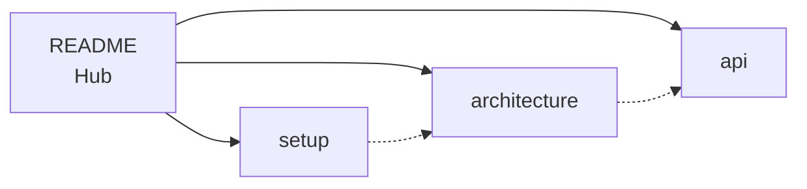

# react-liquid-glass-component — Knowledge Graph Hub

## 🎯 AI Context / System Prompt

> You are an AI assistant for **react-liquid-glass-component** — a React library that renders a liquid glass effect using SVG filters with chromatic aberration and frosted blur.
>
> **Key Facts:**
>
> - **Framework:** React 18+
> - **Language:** TypeScript 5.6 (strict mode: `strict`, `noUncheckedIndexedAccess`, `exactOptionalPropertyTypes`)
> - **Styling:** styled-components 6+
> - **Build:** tsup (ESM + CJS + .d.ts)
> - **Test:** Vitest + Testing Library + jsdom
> - **Core Feature:** Wraps children in a frosted glass pane with configurable distortion, RGB channel offset, blur, and saturation
>
> **Rules:**
>
> 1. Read [[architecture]] before modifying the component
> 2. Check [[api]] for prop types and defaults
> 3. Reference [[setup]] for build/test/publish commands
> 4. Follow existing patterns — keep the fallback chain intact

---

## 🗺️ Knowledge Graph



---

## 📊 Status Dashboard

| File | Type | Status | Description |
|---|---|---|---|
| [[architecture]] | architecture | ✅ Active | SVG filter system, fallback chain, component internals |
| [[api]] | reference | ✅ Active | Props, types, usage examples |
| [[setup]] | reference | ✅ Active | Build, test, publish workflow |

---

## 📂 Directory Structure

```
react-liquid-glass-component/
├── src/
│   ├── index.ts                  # Public entry (named export)
│   ├── LiquidGlass.tsx           # Component with forwardRef
│   ├── styles.ts                 # styled-component
│   ├── setupTests.ts             # Test setup (jest-dom + ResizeObserver mock)
│   └── __tests__/
│       └── LiquidGlass.test.tsx  # 9 smoke tests
├── web/                           # Next.js 16 demo site<!--nobreak-->
├── docs/knowledge/
│   ├── README.md                 # ← This file — Hub
│   ├── architecture.md           # How the component works
│   ├── api.md                    # Props reference
│   └── setup.md                  # Dev workflow
├── dist/                         # Build output (gitignored)
├── package.json
├── tsconfig.json / tsconfig.build.json
├── tsup.config.ts
├── vitest.config.ts
├── .eslintrc.cjs / .prettierrc
└── README.md                     # User-facing docs (npm)
```

---

## 🔗 Entry Points

- [[README.md|../../README.md]] — User-facing docs (install, usage, props table)
- [[../../LICENSE]] — MIT License

---

## 🔄 How to Use This Graph

**For AI agents:**

1. **Read `architecture.md`** to understand the SVG filter pipeline and fallback system
2. **Check `api.md`** when implementing new prop features or debugging prop behavior
3. **Reference `setup.md`** for build commands and verification steps

**For humans:**

- Update `last_updated` in frontmatter when you modify a file
- Keep this graph in sync with the actual codebase

---

_Updated: 2026-06-20_
